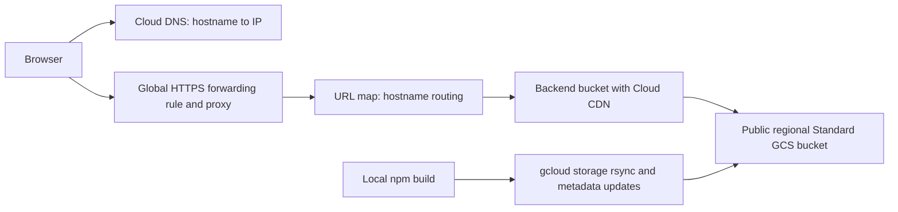

# Static hosting: current GCS costs and alternatives

Research date: 2026-09-30. Repository inspected at `4265f2b`.
Status: research and recommendation; no hosting decision adopted or migration performed.
Scope: ACS Smart Galați static Astro sites, their preview instances, and a future production site. Related requirements: R-SITE-001, R-SITE-003, R-SITE-006 and R-SITE-007 in [REQUIREMENTS.md](../../../REQUIREMENTS.md).

## Findings

**The current setup costs approximately $18.45/month before traffic when it is the sole workload supporting a project's global forwarding-rule group and one Cloud DNS zone.** With the illustrative modest workload below, budget **$19.40/month, or $233/year**. An extra site attached to an already-paid shared frontend and DNS zone adds approximately **$0.95/month** at that same workload. Neither figure is an observed invoice.

The distinction is between **standalone cost**, **allocated share**, and **marginal cost**. Removing one shared preview saves its variable usage; it does not automatically eliminate the infrastructure minimum. Storage itself is negligible for the measured artifacts. The calculations below derive from [Google's load-balancing prices](https://cloud.google.com/load-balancing/pricing), [CDN prices](https://cloud.google.com/cdn/pricing), and the explicitly stated assumptions.

For a new small production site, **Cloudflare Pages or Workers Static Assets is the strongest cost-first shortlist**, with Firebase Hosting the simplest Google-hosted alternative. GitHub Pages is attractive for a single eligible informational site, but less convenient for this repository's many independent candidates. Keep the existing shared GCS deployment if infrastructure control or avoiding migration matters more than a small monthly saving. S3 + CloudFront is the strongest like-for-like bucket/CDN alternative. These are judgments for this project's needs, not universal provider rankings.

## What the repository actually deploys

The deployment graph reconstructed from [scripts/gcs](../../../scripts/gcs/README.md) is:



| Evidence | Cost or operational implication |
|---|---|
| [config.env](../../../scripts/gcs/config.env), [01](../../../scripts/gcs/01-create-bucket.sh) | Default bucket `test2-smartgalati-mycodespace`, Standard, Finland `europe-north1`, project `mycodespace3p`. DNS zone `mycodespace` is in `central-trees-497510-h7`. |
| [02](../../../scripts/gcs/02-configure-website.sh) | Public objects via `allUsers`, website index/error objects; script can relax a project domain-restricted-sharing policy. This is public hosting, not an authenticated preview service. |
| [03](../../../scripts/gcs/03-deploy-site.sh) | Local build; sync deletes unmatched destination objects; then patches immutable asset and five-minute HTML cache headers. No Cloud Build, VM, container runtime, database or paid CI service is provisioned here. |
| [04](../../../scripts/gcs/04-setup-https-loadbalancer.sh) | New global Premium-tier IPv4, Compute Engine managed certificate, CDN backend bucket, URL map, HTTPS proxy, `EXTERNAL_MANAGED` forwarding rule on 443. No port-80 HTTP-to-HTTPS redirect is created by this script. |
| [04b](../../../scripts/gcs/04b-add-to-existing-loadbalancer.sh) | New bucket backend/certificate/host mapping on an existing frontend; no extra IP or forwarding rule. |
| [05](../../../scripts/gcs/05-configure-dns.sh) | Adds an A record to an existing DNS zone, not a new zone per site. |

[Test3 evidence](../../implementation-notes/website/2026-09-27-codex-astra-site.md) and [test4 evidence](../../implementation-notes/website/2026-09-27-claude-rocada-site.md) record test2, test3 and test4 sharing `chessclub-test2` in `mycodespace3p`. Earlier project records also describe `chessclub-site` in `central-trees-497510-h7`. If both projects still retain global frontends, there can be **two separate minima, $36.50/month at 730 hours**, before DNS and usage. This is a conditional inventory estimate, not confirmation that both remain billable today.

The [test5 archive](../../archive/2026-09-27-smartgalati-test5/CURRENT-STATUS.md) records a project `BACKEND_BUCKETS` quota of three blocking another preview. This is a recorded project limit, not a claim that GCP universally allows only three sites. Raising that quota is distinct from buying another load balancer. Live quota and partial test5 resources remain unverified.

Existing local `dist/` artifacts were measured without rebuilding or assuming they match deployed buckets:

| Candidate | Files | Total bytes | Approximate MiB |
|---|---:|---:|---:|
| ag-flash3.8 | 81 | 5,683,591 | 5.42 |
| codex-astra | 238 | 13,925,531 | 13.28 |
| claude-rocada | 564 | 27,516,262 | 26.24 |
| smartgalati-test5 | 283 | 11,658,779 | 11.12 |

The largest individual measured file is 561,700 bytes. These small artifacts fit ordinary static-host limits comfortably. External photo albums, Lichess iframes and the external enrollment form do not require our own application server; bytes served directly by those providers are not this origin's transfer.

## Current GCS cost model

### Rates and billing boundaries

All amounts are public USD list prices before taxes, exchange-rate effects, negotiated discounts and temporary credits. Use actual provisioned hours; 730 is an average planning month, not September's 720 hours. GiB means 2^30 bytes.

| Component | Rate used / treatment | Primary source |
|---|---|---|
| Global forwarding rules | First 1–5 together: $0.025/hour per project; each beyond five: $0.01/hour | [Load balancing pricing](https://cloud.google.com/load-balancing/pricing) |
| Attached frontend IP | No separate IP charge while attached to a forwarding rule; a reserved unused address is a different case | [VPC external IP pricing](https://cloud.google.com/vpc/pricing#ipaddress) |
| Managed certificate | No separate certificate charge assumed for the Compute Engine managed-certificate path in the scripts; no per-connection managed-certificate charge | [Load balancing SSL pricing](https://cloud.google.com/load-balancing/pricing#ssl-certificates) |
| GCS storage | Planning input $0.020/GiB-month, regional Standard | [Storage pricing](https://cloud.google.com/storage/pricing) |
| GCS operations | Flat namespace Standard: Class A $0.005/1,000; Class B $0.0004/1,000 | [Storage operations](https://cloud.google.com/storage/pricing#operations-pricing) |
| CDN transfer to European clients | $0.08/GiB in the first 10 TiB/month tier | [Cloud CDN pricing](https://cloud.google.com/cdn/pricing) |
| CDN fill within Europe | $0.01/GiB | [Cloud CDN pricing](https://cloud.google.com/cdn/pricing) |
| CDN lookups | $0.0075/10,000 requests | [Cloud CDN pricing](https://cloud.google.com/cdn/pricing) |
| Cloud DNS | $0.20/zone-month for the first 25 zones; $0.40/million regular queries in the first tier | [DNS pricing](https://cloud.google.com/dns/pricing) |

**Regional-rate evidence limit:** Google's storage page text extraction defaults to Iowa rather than exposing the selected Finland price. $0.020 is an explicit planning input, not a claim of a captured Finland-specific quote. Reconfirm [Finland Standard SKU `8A7F-592F-3FE7`](https://cloud.google.com/skus/sku-groups/standard-storage-regional) in the billing catalogue when reconciling. Even doubling this input changes the 0.1-GiB example by only $0.002/month. Storage allowances limited to eligible US regions should not be assumed for Finland. [Storage pricing and free-tier conditions](https://cloud.google.com/storage/pricing#cloud-storage-always-free).

For cacheable GCS-backed content, a hit incurs CDN delivery and lookup; a miss additionally incurs fill and applicable storage operations. Do **not** add normal GCS internet egress again to the same CDN-filled bytes. Non-cacheable traffic has a different billing path and is outside the numerical examples. [CDN billing cases](https://cloud.google.com/cdn/pricing).

The model interprets Google's cache-miss table as storage operations for the GCS origin, rather than adding VM load-balancer processing. It does not apply the $0.008/GiB processing meter to cache hits. Reconcile any processing SKUs against actual traffic paths: if processing applies to miss responses, add $0.008 per processed GiB (only $0.008 for the modest example's 1-GiB miss volume), plus applicable request bytes. [CDN billing cases](https://cloud.google.com/cdn/pricing), [load-balancing pricing](https://cloud.google.com/load-balancing/pricing).

### Reusable formula

For one project, if `n` global forwarding rules are provisioned for the same `H` hours:

```text
Forwarding(n,H) = 0                                      if n = 0
                = H × [0.025 + 0.01 × max(n − 5, 0)]    otherwise

Variable = 0.020 × S       # billable storage GiB-month, including retained objects
         + 0.000005 × A   # Class A operations, including deployment metadata writes
         + 0.0000004 × B  # Class B operations, including origin reads
         + 0.08 × D       # cacheable delivery GiB to European clients
         + 0.01 × F       # intra-Europe cache-fill GiB
         + 0.00000075 × R # CDN lookup requests
         + 0.0000004 × Q  # authoritative regular DNS queries

Standalone = Forwarding(1,H) + 0.20 + Variable
Allocated per site = its Variable + chosen share of shared fixed costs
Marginal extra site via 04b = its Variable, while existing fixed costs remain
```

Meter changing rule counts by actual intervals. Regional rules are a separate group. A new dedicated frontend in the **same project** may still add no minimum while the group stays within five; a new project starts another group. The shared design also avoids consuming extra frontend resources and simplifies certificate/routing administration.

### Illustrative monthly costs

Assumptions: 730 hours; 0.1 GiB billable storage; 10,000 Class A operations/month; all response content cacheable; Europe-only delivery and fill; fill bytes `F = 10% × D`; origin Class B reads `B = 10% × R`; DNS queries `Q = 10% × R`. Byte and request hit rates are separate assumptions. These are scenarios, not measured traffic forecasts. The operation allowance costs $0.05 and includes frequent sync/metadata work.

| Scenario | Delivery/month | Asset requests/month | Standalone, including zone | Each of 3 equal sites sharing one frontend group and zone | Incremental extra site |
|---|---:|---:|---:|---:|---:|
| Tiny preview | 1 GiB | 10,000 | $18.59 | $6.29 | $0.14 |
| Modest club site | 10 GiB | 100,000 | **$19.40** | **$7.10** | **$0.95** |
| Busy site | 100 GiB | 1,000,000 | $27.43 | $15.13 | $8.98 |
| Large traffic month | 1,000 GiB | 10,000,000 | $107.80 | $95.50 | $89.35 |

For the modest example: storage $0.002 + writes $0.050 + reads $0.004 + delivery $0.800 + fill $0.010 + lookups $0.075 + DNS queries $0.004 = **$0.945 variable**, plus $18.25 forwarding and $0.20 zone = **$19.395**. Three such sites cost **$21.285/month total**. Each site's $7.095 allocated share is accounting, not the saving achieved by removing it.

A 720-hour September lowers each standalone example by $0.25. With zero traffic and no deployment operations, the 0.1-GiB standalone example is approximately $18.452/month. At the modeled rate the largest measured artifact's live storage alone is about $0.00051/month.

Translate visitors into transfer before estimating: 10,000 page views at 1 MiB actually transferred per view is about 9.77 GiB. A page with ten assets makes many requests; browser cache reuse reduces both bytes and requests. Bot traffic still contributes. A cold low-traffic preview may have much worse cache reuse than the assumed 90%: at 10 GiB and 100,000 requests, 100% misses increase this model by roughly $0.126, provided fill remains within Europe. This is a sensitivity calculation, not a measured hit rate.

### Costs hidden by a “bucket costs pennies” estimate

- **Deployments and retained files:** sync, list, metadata and upload operations are metered. The scripts do not configure retention/lifecycle explicitly. Default soft deletion can retain replaced/deleted objects for seven days and charge storage during retention. Frequent complete rebuilds can retain several generations. [Soft-delete behavior](https://docs.cloud.google.com/storage/docs/lifecycle).
- **Origin bypass:** the public bucket can be accessed directly. Direct downloads need their own storage transfer/operation accounting and can bypass CDN-only protections. The cacheable-path table does not include such traffic.
- **Logs and security products:** the scripts do not provision an explicit paid logging pipeline or Cloud Armor policy. Add their charges if enabled elsewhere; do not silently include them in this baseline.
- **Builds, domain and labor:** local `npm run build` is not free labor or free hardware, but it creates no cloud build line item here. CI runners, artifact retention, registrar renewals, paid support and operator time are separate. An additional subdomain in the existing zone does not require another domain registration.
- **Idle infrastructure:** an abandoned frontend continues incurring its group's minimum; deleting only objects, host records or a backend bucket may not reduce that minimum. Inspect both projects before estimating migration savings.
- **Operational work:** shared URL maps/certificates have a wider change blast radius. The test4 evidence records cache metadata being applied after upload, allowing an early response to cache old headers. Sync also lacks an atomic release switch and deletes old assets immediately, so old cached HTML can reference removed files. Managed deployment platforms can reduce the amount of release machinery we maintain.

### How to establish the actual bill

No authenticated cloud inventory, traffic measurements or billing export was available: this environment has no `gcloud` executable. Repository evidence cannot establish retained versions, dangling resources, discounts, or September spend.

On an authenticated workstation, use read-only inventory commands such as:

```bash
gcloud compute forwarding-rules list --project=mycodespace3p --global
gcloud compute forwarding-rules list --project=central-trees-497510-h7 --global
gcloud compute addresses list --project=mycodespace3p
gcloud compute addresses list --project=central-trees-497510-h7
gcloud compute backend-buckets list --project=mycodespace3p
gcloud storage buckets describe gs://test2-smartgalati-mycodespace
gcloud storage du --summarize gs://test2-smartgalati-mycodespace
gcloud dns managed-zones list --project=central-trees-497510-h7
```

Repeat bucket inspection for every candidate; live-object `du` alone is not retained-storage accounting. Then export a complete calendar month's Billing Reports/Cost Table for **both projects**, grouped by project, service and SKU. Separate gross usage from credits and taxes. Identify forwarding-rule hours, CDN delivery/fill/lookups, storage byte-time/operations, DNS, unused addresses and any logging/security SKUs. Compare metered usage with the formula. Attribute variable traffic by backend/hostname using available metrics or logs; a project-total invoice is not inherently a per-hostname bill. Allocate unavoidable shared minimums explicitly.

This produces three defensible numbers: total portfolio cash cost, allocated cost per site, and avoidable cost if a particular site or the whole frontend group is retired. Avoid extrapolating a few days of certificate provisioning into a full-month historical bill.

## Hosting alternatives

Costs below exclude registrar fees and operator time. Free allocations may be shared across an account/project/subscription; they are not automatically multiplied by the number of hostnames. Prices and limits were checked on the research date.

| Option | Price basis for a small static site | Strengths for this repository | Main tradeoff / assessment |
|---|---|---|---|
| **Current GCS + global LB + CDN** | Approximately $19.40 standalone or $0.95 marginal at modeled 10 GiB | Existing tooling, independent buckets/domains, explicit regional origin, flexible routing | More infrastructure and quotas to operate. Reasonable to retain as a shared portfolio; expensive for an isolated tiny site. |
| **GitHub Pages** | $0 hosting on eligible plan/repository; private-source plan and CI costs may remain | Repo-native publishing, custom domain/HTTPS, no cloud credentials for bucket sync | Limited hosting controls and no native independent preview fleet per repo. Usage policy matters. Strong for one eligible informational site. |
| **Cloudflare Pages / Workers Static Assets** | $0 for static delivery within platform limits | No per-GiB static egress bill; simple static deployment; Pages previews suit candidate review | Domain/DNS conditions, asset/build limits, provider configuration. Best cost-first pilot. |
| **Firebase Hosting** | No hosting minimum; free allowance then $0.15/GB transfer | Google ecosystem, managed CDN/TLS, preview channels, release rollback | Transfer becomes relatively expensive at scale; allowances shared per project. Best Google-native simplification. |
| **AWS S3 + CloudFront** | No GCP-style forwarding-rule minimum; free-tier/flat-plan choices plus applicable origin costs | Bucket model, private origin possible, mature CDN/routing controls | More setup than a static platform, especially nested directory URLs and release orchestration. Best bucket-based alternative. |
| **Azure Blob + Front Door Standard** | $35/month frontend base plus transfer, requests and Blob | Azure ownership, routing and enterprise integration | Higher minimum than current GCS. Poor choice solely to save money on this site. |
| **Azure Static Web Apps** | Free tier or Standard $9/app-month in West Europe, plus overages | Managed static deployment, TLS, staging and Azure integration | Free tier intended for hobby/personal use; subscription-wide bandwidth allowance. Better Azure fit than assembling Blob + Front Door. |
| **Netlify** | Free 300 credits; Personal $9; Pro starts $20/month | Convenient previews and integrated publishing/forms | Deploys and traffic consume the same pool; exhaustion can pause all team sites. Useful features, less attractive pure delivery economics. |
| **Vercel** | Hobby $0 for personal noncommercial use; Pro $20/month including one deploying seat, plus overages/seats | Preview workflow and potential future application features | Club site should not assume Hobby eligibility; much of the platform is unnecessary for static HTML. |

### GitHub Pages

Public repositories can use Pages on GitHub Free; private repositories require a supporting paid plan. Published sites have a 1-GB limit and a 100-GB/month soft bandwidth limit. GitHub excludes sites primarily facilitating commercial transactions and free hosting of an online business. The club's informational site may fit, but enrollment in paid coaching means eligibility should be checked rather than inferred from nonprofit status. [Pages availability, limits and usage policy](https://docs.github.com/en/pages/getting-started-with-github-pages/github-pages-limits).

Use an Astro build through a [custom Actions workflow](https://docs.github.com/en/pages/getting-started-with-github-pages/using-custom-workflows-with-github-pages). Custom domains and HTTPS are supported. A repository provides one project site, so test2–test5 would need separate publishing repos or a path-based showcase, rather than the current independent hostnames served from one repo. [Pages site types](https://docs.github.com/en/pages/getting-started-with-github-pages/what-is-github-pages), [custom domains](https://docs.github.com/en/pages/configuring-a-custom-domain-for-your-github-pages-site/about-custom-domains-and-github-pages).

There is no equivalent of our freely configurable URL map/object cache metadata in ordinary Pages settings. Preserve redirects as static artifacts where possible, and test canonical URLs and error status behavior. In our judgment its simplicity suits the eventual single selected site better than the present design-comparison portfolio. Do not make the entire repository public merely to obtain free hosting without reviewing its contents and owner intent.

### Cloudflare Pages and Workers Static Assets

Static asset requests on Pages are free and unlimited when they do not invoke Functions. Workers Static Assets also has free static requests and storage. This does not make arbitrary Worker execution free. [Pages billing](https://developers.cloudflare.com/pages/functions/pricing/), [Workers asset billing](https://developers.cloudflare.com/workers/static-assets/billing-and-limitations/).

Pages Free allows 500 builds/month, 20,000 files/site, 25-MiB files and unlimited active preview deployments. Workers Free likewise supports 20,000 static files/version and 25-MiB individual files. Our artifacts fit by a wide margin. [Pages limits](https://developers.cloudflare.com/pages/platform/limits/), [Workers limits](https://developers.cloudflare.com/workers/platform/limits/).

For `smartgalati-testN.mycodespace.ai`, Pages supports an external-DNS CNAME after the hostname is registered in Pages. For an apex such as `smartgalati.ro`, Pages requires the zone's nameservers at Cloudflare. That would involve existing mail and other DNS records as well as the website; a subdomain pilot avoids an immediate zone migration. [Custom-domain requirements](https://developers.cloudflare.com/pages/configuration/custom-domains/).

Use a separate Pages project per candidate with its own build directory. For a new CLI-managed deployment, also evaluate Workers Static Assets; it serves static output without requiring SSR. Keep headers, redirects and build configuration in Git. The tradeoff is platform limits and DNS integration in exchange for removing several cloud resources and bandwidth billing concerns. Free delivery does not imply a contractual availability/support commitment; assess that separately if the club requires one.

### Firebase Hosting

Use **Firebase Hosting**, not Firebase App Hosting or Cloud Storage for Firebase. Hosting includes global CDN/TLS, custom domains, preview channels and release management, matching this static application. [Hosting capabilities](https://firebase.google.com/docs/hosting).

The detailed Hosting guide specifies 10 GB stored free and 10 GB/month transfer free, then $0.026/GB-month stored and $0.15/GB transferred on Blaze. Spark can disable sites after its transfer allowance/grace period. Multiple sites share project quotas; retained releases consume storage. [Hosting quota guide](https://firebase.google.com/docs/hosting/usage-quotas-pricing).

**Documentation discrepancy:** the [pricing overview](https://firebase.google.com/pricing) still presents transfer as 360 MB/day. Use the detailed guide's monthly allowance for this illustration, but confirm the project's console before choosing a plan. At 100 provider-billed GB/month, the monthly interpretation gives `(100 − 10) × $0.15 = $13.50`; at 1,000 GB, $148.50. These use Firebase's GB notation, not a claim that its units exactly match the GCS GiB scenarios.

This avoids our standalone frontend minimum while retaining Google ownership, but can be more expensive than shared GCS as traffic grows. Native redirects/headers and preview workflows reduce work otherwise handled by scripts.

### AWS S3 + CloudFront

Prefer an S3 REST origin protected by CloudFront Origin Access Control if a private bucket is wanted. An S3 website endpoint is instead a custom origin and cannot use OAC. [AWS origin-access documentation](https://docs.aws.amazon.com/AmazonCloudFront/latest/DeveloperGuide/private-content-restricting-access-to-s3.html).

CloudFront pay-as-you-go currently includes 1 TB/month transfer and 10 million requests across the account; other workloads can consume that allowance. [CloudFront FAQ](https://aws.amazon.com/cloudfront/faqs/). Separate flat-rate plans offer $0 Free and $15 Pro, with no plan overage charges. [Plan pricing](https://aws.amazon.com/cloudfront/pricing/). Free includes 100 GB/1 million requests; Pro 50 TB/10 million. Plans have eligibility and feature restrictions, a maximum of three Free plans/account and one apex domain per plan. Sustained substantial excess can reduce delivery performance. Check account eligibility, including the documented AWS Free Tier account exclusion. DNS and S3 credits are conditional plan inclusions, not all-origin-cost cancellation. [Flat-rate plan rules](https://docs.aws.amazon.com/AmazonCloudFront/latest/DeveloperGuide/flat-rate-pricing-plan.html).

The [official S3 Ireland price feed](https://pricing.us-east-1.amazonaws.com/offers/v1.0/aws/AmazonS3/current/eu-west-1/index.json), retrieved on the research date, lists Standard storage at $0.023/GB-month for the first tier, PUT/COPY/POST/LIST at $0.005/1,000 and GET/other reads at $0.0004/1,000. At 0.1 billed GB stored, 10,000 writes and 10,000 reads, origin cost is approximately **$0.0563/month**, before credits and other operations. With unused CloudFront allowances and existing DNS, a small site can therefore cost cents rather than having an $18.25 forwarding minimum. This excludes build jobs, functions, logs, invalidations beyond allowances and direct S3 downloads. [S3 pricing boundaries](https://aws.amazon.com/s3/pricing/).

Migration is not just `rsync` with an AWS command: CloudFront's default root object does not automatically resolve every nested `/path/` to `/path/index.html`. Add/test a rewrite function or a suitable publishing layout, plus real 404s and old-URL redirects. [Default-root-object behavior](https://docs.aws.amazon.com/AmazonCloudFront/latest/DeveloperGuide/DefaultRootObject.html). This operational work is the main disadvantage versus Pages/Firebase.

### Azure alternatives

Blob's static website feature does not add a hosting fee beyond storage/operations, but custom-domain HTTPS needs a frontend. [Blob website limitations](https://learn.microsoft.com/en-us/azure/storage/blobs/storage-blob-static-website). Front Door Standard has a $35/month base, European delivery at $0.083/GB in the first tier, and $0.009/10,000 requests. At 10 billed GB and 100,000 requests, that frontend is approximately **$35.92/month**, plus Blob, DNS and other applicable usage. [Front Door pricing](https://azure.microsoft.com/en-us/pricing/details/frontdoor/). Share the profile across sites to allocate its base, but that does not improve the isolated-site case.

Azure Static Web Apps is the more proportionate product. Both tiers include 100 GB bandwidth **per subscription**, custom domains and TLS. Free is positioned for personal/hobby work without SLA; exceeding its quota stops serving. [Static Web Apps pricing](https://azure.microsoft.com/en-us/pricing/details/app-service/static/). The [Azure retail API, West Europe](https://prices.azure.com/api/retail/prices?%24filter=productName%20eq%20%27Static%20Web%20Apps%27%20and%20armRegionName%20eq%20%27westeurope%27&currencyCode=USD) returned Standard App $9/month, with bandwidth $0.20/GB after 100 GB. The optional Front Door add-on is a separate meter, excluded here. With unused allowance, 10 GB/month fits the $9 Standard base.

### Netlify and Vercel

Netlify's current Free/Personal/Pro plans include 300/1,000/3,000 starting monthly credits at $0/$9/$20. [Plans](https://www.netlify.com/pricing/). Meter rates are 15 credits/production deploy, 20/GB bandwidth and 2/10,000 web requests. Four production deploys, 10 GB and 100,000 requests consume **280 credits**, barely within Free; twenty deploys consume the entire free pool before traffic. Exhausting credits pauses team projects; paid recharge is optional. Previews/branch deploys do not consume production-deploy credits, but traffic still matters. [Credit accounting](https://docs.netlify.com/manage/accounts-and-billing/billing/billing-for-credit-based-plans/how-credits-work/). Its authoring/review convenience is valuable, but frequent candidate publishing makes the credit pool material. Legacy accounts can have different plans.

Vercel Hobby is personal and noncommercial; do not assume a club's operational website qualifies. [Hobby rules](https://vercel.com/docs/plans/hobby). Pro is $20/month with one deploying seat, 1 TB transfer and 10 million edge requests included, with additional deploying seats and metered overages. [Pro pricing](https://vercel.com/docs/plans/pro-plan). Good previews and future application features may justify it for another product; here, static delivery and external forms leave little reason to pay that premium.

### Other storage and server choices

Cloudflare R2 is a useful future media store: Standard storage $0.015/GB-month, Class A $4.50/million, Class B $0.36/million and no internet egress fee, with a free allocation. [R2 pricing](https://developers.cloudflare.com/r2/pricing/). A production custom domain enables caching; the development `r2.dev` endpoint is rate-limited. [Public buckets](https://developers.cloudflare.com/r2/buckets/public-buckets/). Treat R2 as an object/media origin, not a drop-in Astro directory-index/redirect host; use Pages/Workers for the website routing. Large local galleries might justify it later, but current requirements deliberately use external albums.

A VPS or an existing shared web server can serve the same HTML, but shifts TLS renewal, patching, backups and availability to the operator. No provider-specific VPS quote was researched because this project has no runtime-server requirement. Serverless containers likewise add packaging and routing work without a current functional benefit. Reconsider them if a first-party authenticated application or server-side processing becomes an accepted requirement.

## Weighing the decision for this project

The following priorities are inferred from the repository, not an adopted architecture decision: low recurring cost, low volunteer-maintainer effort, reliable custom-domain HTTPS, independent candidate previews, and portable static output.

1. **Pilot Cloudflare static hosting for one candidate.** It removes the frontend minimum and CDN egress meter while matching today's application. Compare Pages' preview convenience with Workers Static Assets' CLI deployment. Validate subdomain setup before discussing apex DNS movement.
2. **Choose Firebase Hosting if remaining with Google and retaining current DNS ownership is preferable.** Its release/preview facilities address operational gaps in our scripts. Measure monthly transfer before accepting Blaze's growth curve.
3. **Use GitHub Pages if the final site is eligible and one repository/site is enough.** It is a good minimum-administration option; check usage policy and private-repository plan before selecting it.
4. **Retain shared GCS when its controls or existing investment are valuable.** Another modest preview costs roughly a dollar/month in this model. Migrating only that preview for savings may not repay implementation time; retiring the last frontend in a project is what can remove the minimum.
5. **Choose S3 + CloudFront if bucket/CDN ownership is a deliberate preference.** It has attractive low-volume economics and private-origin support, but requires URL/deployment engineering. Azure Blob + Front Door is not a cost-driven improvement here.

The static HTML, CSS, JS and Markdown architecture keeps content portable across all shortlisted platforms. Provider-specific redirect rules, image transformation services, functions and form handlers would increase migration work; retain build-time image optimization and the external enrollment link unless product requirements change.

A regional Finland bucket locates the origin there, but does not imply all CDN copies or request logs remain in Finland or the EU. None of the current comparison figures proves a residency guarantee. The site publishes coach and youth-related material; any future stricter residency requirement should be evaluated against actual processing/storage contracts, including the external photo/form providers.

Cloud spend is only part of ownership cost. For an illustrative labor value of $40/hour, a four-hour migration costs $160: saving the modeled $19.40 standalone bill pays back in about 8.3 months, while saving only a $0.95 shared-site increment takes about 14 years. These labor assumptions are illustrative, not quotations. Easier publishing or better rollback can justify a change even when direct savings are small.

## Proposed next step and acceptance checks

First reconcile one complete month's two-project bill and frontend inventory. Then, if the owner selects a migration pilot, deploy one existing `dist/` to a nonproduction hostname and compare:

- Root and nested routes, trailing slashes, old news/archive addresses, canonical URLs, sitemap and actual 404 status.
- HTTP-to-HTTPS behavior, custom-domain certificate, cache headers and one content update followed by rollback.
- Asset availability across deploys, Lichess embeds, photo galleries, external form and contact links.
- Candidate isolation, preview access expectations, maintainer permissions and reproducible CI/local build.
- Mobile performance from Romania and actual transferred bytes; this research did not benchmark provider latency.

Production-domain cutover and retirement of shared resources require a separate owner decision. Retire resources only after enumerating their other hostnames; preserve a rollback window. Revisit this note when measured usage differs materially, platform prices/terms change, the candidate portfolio is retired, or backend/residency/SLA requirements appear.
